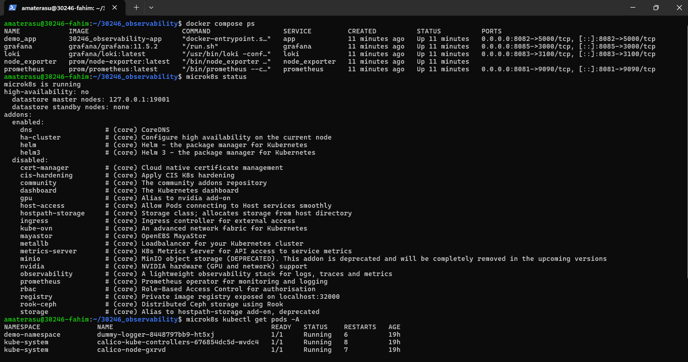
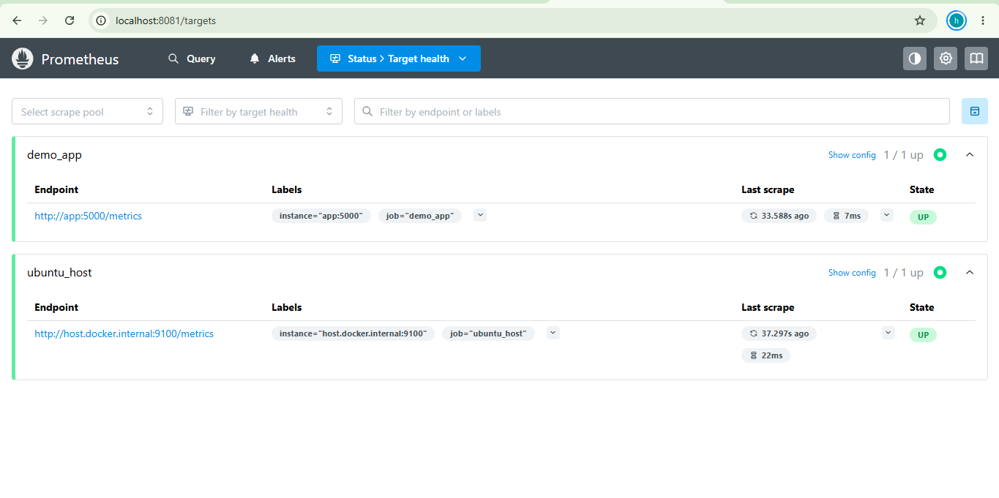
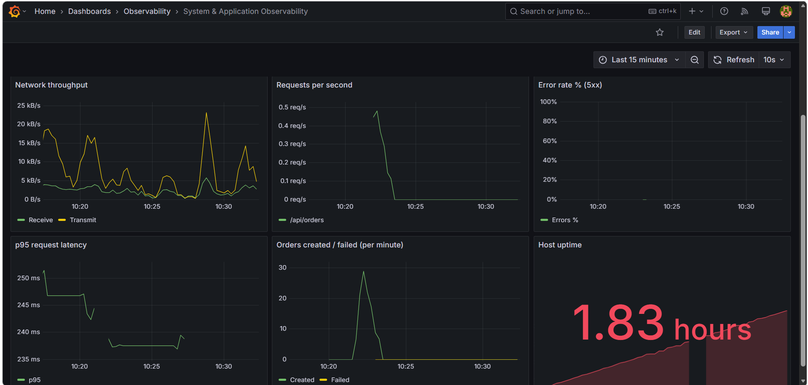
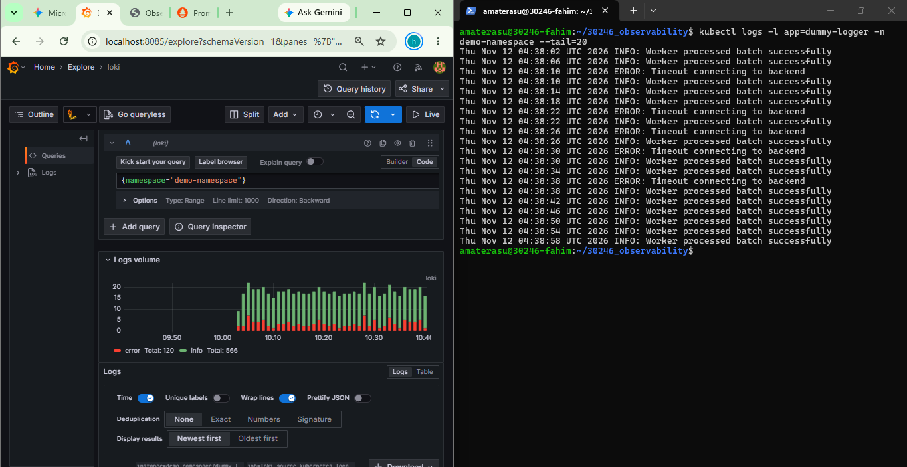
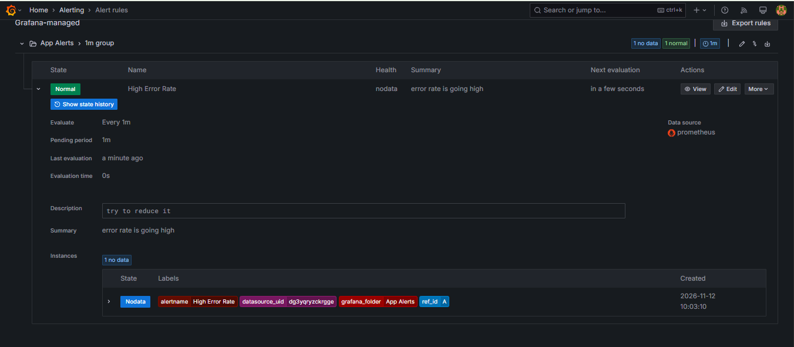

# System & Application Observability Platform

**Candidate ID:** [30246]  
**Date:** 11 Nov 2026  
**Environment:** Ubuntu (WSL 2) / Docker Engine / MicroK8s  

---

## 🏗️ Architecture Overview

This project implements a hybrid observability pipeline bridging a native Docker host and a local Kubernetes cluster, providing unified metrics, logs, and alerting.

*   **Metrics Ingestion (The "Numbers"):** A native Node.js application and a Node Exporter container run on the host. A local Prometheus instance pulls (scrapes) telemetry from these endpoints every 15 seconds to track application request rates, latency, errors, and physical host hardware utilization.
*   **Log Collection (The "Text"):** A dummy workload runs inside a MicroK8s cluster generating standard output and error streams. **Grafana Alloy** is deployed as a DaemonSet within the cluster, automatically discovering the pod logs and pushing them via HTTP to a **Loki** instance running on the Docker host.
*   **Visualization & Querying:** **Grafana** acts as the single pane of glass, utilizing PromQL to render metrics dashboards and LogQL to stream live Kubernetes pod logs.
*   **Alerting Delivery:** Grafana evaluates live metric conditions (e.g., HTTP 500 Error Rate > 0). Upon a breach, it authenticates with a secure SMTP relay (Gmail) to deliver an actionable notification to the operator's inbox.

### 💡 Known Limitation & Future Improvement
Currently, the SMTP credentials (app password) are passed as environment variables within the `compose.yaml`. While they are excluded from version control via `.gitignore` and `.env`, injecting secrets as plain environment variables can expose them to host-level process inspections. 
**Improvement:** In a production environment, I would integrate a dedicated secret manager (like HashiCorp Vault, AWS Secrets Manager, or native Docker Secrets) to mount these credentials securely into the container at runtime.

---

## 📂 Project Structure

```text
candidate-ID_observability/
├── README.md
├── compose.yaml
├── app/
│   ├── Dockerfile
│   ├── index.js
│   └── package.json
├── prometheus/
│   └── prometheus.yml
├── loki/
│   └── config.yml
├── kubernetes/
│   ├── alloy-values.yaml
│   └── workload.yaml
└── evidence/               # Contains screenshot proofs
    ├── compose-and-cluster.png
    ├── prometheus-targets.png
    ├── grafana-metrics.png
    ├── kubernetes-logs.png
    └── email-alert.png
```

---

## 🚀 Setup & Deployment Instructions

### 1. Prerequisites
Ensure you have the following installed on an Ubuntu host (or WSL 2 with systemd enabled):
*   Native Docker Engine & Docker Compose V2
*   MicroK8s (with DNS addon enabled)

### 2. Start the Metrics & Storage Backend
Spin up the host-level Docker Compose stack containing the App, Prometheus, Loki, Node Exporter, and Grafana:
```bash
docker compose up -d
```
Verify all 5 containers are running:
```bash
docker compose ps
```

### 3. Deploy the Kubernetes Workload & Log Forwarder
Apply the dummy workload that generates standard logs and errors:
```bash
kubectl apply -f kubernetes/workload.yaml
```
Install Grafana Alloy via Helm to read the pod logs and forward them to Loki:
```bash
helm repo add grafana https://grafana.github.io/helm-charts
helm repo update
helm install alloy grafana/alloy -f kubernetes/alloy-values.yaml --namespace observability-system --create-namespace
```
Verify the Alloy pod is running:
```bash
kubectl get pods -n observability-system
```

---

## 🚦 Accessing the Services

All services are exposed on `localhost` for local development and testing:

| Service | Address | Credentials / Info |
| :--- | :--- | :--- |
| **Grafana** | [http://localhost:8085](http://localhost:8085) | `admin` / `admin` |
| **Prometheus Targets** | [http://localhost:8081/targets](http://localhost:8081/targets) | No auth required |
| **Order API (App)** | [http://localhost:8082/health](http://localhost:8082/health) | `GET /health`, `POST /api/orders` |
| **App Metrics** | [http://localhost:8082/metrics](http://localhost:8082/metrics) | Raw Prometheus exposition |

---

## 🧪 Testing & Verification

### 1. Generating Traffic & Errors
To populate the Grafana dashboard with realistic application metrics and trigger the error rate alert, run this loop in your terminal. It continuously simulates user orders and random backend failures (HTTP 500s).

```bash
while true; do \
  curl -s -X POST -H "Content-Type: application/json" -d '{"item":"test_widget"}' http://localhost:8082/api/orders; \
  sleep 0.5; \
done
```

### 2. Verifying Logs
To verify that Kubernetes logs are successfully reaching Loki:
1. Open Grafana and navigate to **Explore**.
2. Select the **Loki** data source.
3. Run the LogQL query: `{namespace="demo-namespace"}`. You will see live INFO and ERROR logs streaming from the cluster.

---

## 📸 Assessment Evidence

*(Evaluator Note: The following screenshots validate the practical outcomes required by the assessment checklist.)*

### 1. Environment & Tools

> **Candidate Action:** Take a screenshot of your terminal showing the output of `docker compose ps` and `kubectl get pods -A`. Save it as `compose-and-cluster.png` in the `evidence` folder.

### 2. Prometheus Target Health

> **Candidate Action:** Take a screenshot of your browser at `http://localhost:8081/targets` showing both `ubuntu_host` and `order_app` in the green **UP** state. Save it as `prometheus-targets.png`.

### 3. Grafana Metrics Dashboard

> **Candidate Action:** Take a full-screen screenshot of your finished Grafana dashboard showing all 8 metric panels with actual data flowing in. Save it as `grafana-metrics.png`.

### 4. Kubernetes Log Query

> **Candidate Action:** Take a screenshot of the Grafana **Explore** tab showing the Loki logs filtering `{namespace="demo-namespace"}`. Save it as `kubernetes-logs.png`.

### 5. Email Alert Delivery

> **Candidate Action:** Take a screenshot of the actual email you received in your Gmail inbox from Grafana. Redact/blur any personal info if you want, but show the subject line and timestamp. Save it as `email-alert.png`.

---

## 🧹 Cleanup

To completely remove the observability stack, workloads, and localized data volumes, run the following commands:

```bash
# 1. Remove the Kubernetes log forwarder and workload
helm uninstall alloy --namespace observability-system
kubectl delete -f kubernetes/workload.yaml

# 2. Spin down the Docker Compose stack and delete named volumes
docker compose down -v
```
